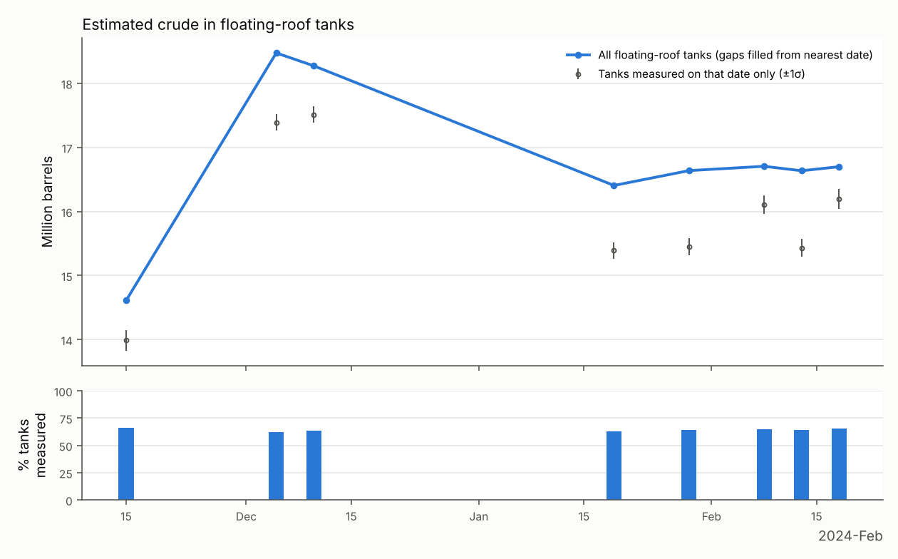
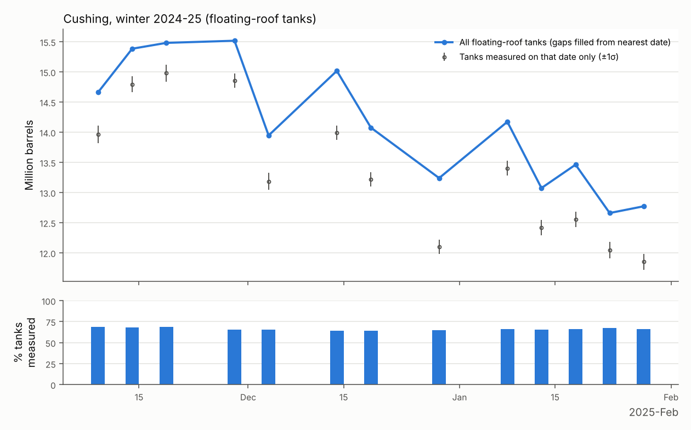

# tankfill

Estimate how full floating-roof crude tanks are from free Sentinel-2 imagery by
fitting a forward model of their shadows. This is a learning project that
reproduces the commercial method at 10 m resolution. It is not a trading signal.

## Install

```bash
pip install -e .                 # numpy, scipy, pandas, matplotlib, rasterio, pyproj, pystac-client
pip install -e '.[planetary]'    # only if you want --source planetary-computer
pip install xlrd                 # only to read the EIA .xls file directly
```

## Data access: what you need to sign up for

**Nothing.** No account, no key and no payment for any of the three sources:

| `--source` | What it is | Signup |
|---|---|---|
| `earth-search` (default) | Element 84 STAC API over the public AWS bucket `sentinel-cogs` | none |
| `planetary-computer` | Microsoft STAC API; asset URLs are signed anonymously with SAS tokens | none (needs `pip install planetary-computer`) |
| `aws-s3` | No search API. It lists the public bucket by MGRS tile (`14SQE` for Cushing) and reads each scene's STAC JSON | none |

Copernicus Data Space is **not** used: its downloads need a (free) account and
an OAuth token, which is friction for no gain here.

Only the pixels inside your bounding box are read (COG range requests), so a scene costs
about 1–2 MB.

## Pipeline

```bash
# 1. Imagery: a summer month for detection, a winter for measurement
tankfill -v download --site cushing --start 2023-07-01 --end 2023-08-31 --out data/cushing/summer
tankfill -v download --site cushing --start 2023-11-01 --end 2024-02-28 --out data/cushing/winter

# 2. Tanks from the highest-sun summer scene (red band, bright discs)
tankfill -v detect data/cushing/summer/2023-07-18_*.tif --out tanks.csv --diagnostics diag/detect

# 3. One winter scene (NIR)
tankfill -v measure data/cushing/winter/2023-12-10_*.tif --tanks tanks.csv \
    --out m_2023-12-10.csv --diagnostics diag/m_2023-12-10

# 4. Lock heights from several winter results (also flags fixed-roof suspects)
tankfill heights m_*.csv --tanks tanks.csv --out tanks_locked.csv

# 5. Whole winter -> site total per date + chart (does step 4 itself if heights are not locked)
tankfill -v timeseries data/cushing/winter --tanks tanks.csv --out ts --diagnostics \
    --eia W_EPC0_SAX_YCUOK_MBBLw.xls

# Synthetic scenes with known answers, to see what the method can and cannot do
tankfill simulate --out data/synthetic
```

`--site dongjiakou` is also defined (119.76–119.86 E, 35.56–35.64 N). That
box is a rough guess; check it on the first downloaded image and pass your
own `--bbox W S E N` if the tank farm is cut off.

EIA Cushing stocks: series `W_EPC0_SAX_YCUOK_MBBL`, "Download Data (XLS File)" at
<https://www.eia.gov/dnav/pet/hist/LeafHandler.ashx?n=PET&s=W_EPC0_SAX_YCUOK_MBBL&f=W>.
A two-column CSV (date, thousand barrels) also works.

## The model

Local frame centred on the tank, with $d$ the unit vector pointing away from the sun
(grid azimuth, corrected for UTM meridian convergence: about 1.3° at Cushing).

$$
L_e = \frac{H}{\tan(\mathrm{el})},\qquad
L_i = \frac{H - h}{\tan(\mathrm{el})},\qquad
\mathrm{fill} = \frac{h}{H} = 1 - \frac{L_i}{L_e}
$$

- lit roof $=\ \mathrm{disc}(0,R)\ \cap\ \mathrm{disc}(L_i\,d,\ R)$
- interior shadow $=\ \mathrm{disc}(0,R) \setminus \text{lit roof}$
- exterior shadow $=\ \mathrm{stadium}(0 \to L_e\,d,\ R) \setminus \mathrm{disc}(0,R)$

Each class is rendered on a 2 m grid with anti-aliased edges, so the coverage
moves continuously with $L_i$ and $L_e$. Each coverage map is blurred with a
Gaussian PSF ($\sigma = 4.5$ m) and box-averaged to the 10 m pixels. With $L$
the lit-roof coverage and $S$ the roof-plus-shadow coverage, a pixel is

$$
p = g\,(1 - S) + r\,L + s\,(S - L)
$$

The levels $g, r, s$ come from linear least squares at every evaluation, so the
optimiser only searches geometry. It runs a coarse grid over $(L_i, L_e)$ first,
because the objective has local minima at pixel scale, and then Nelder-Mead with an
explicit initial simplex. That avoids scipy's 0.00025 step for parameters
starting at 0, the pitfall you described.

Measure runs in two passes:

1. On up to 40 of the largest tanks: fit offset $(dx, dy)$ and shadow lengths,
   with $s$ free. The **median** offset becomes the scene geolocation offset.
   The median $s$ over tanks with at least 2 px of shadow becomes the scene
   shadow brightness.
2. On every tank: offset and $s$ fixed, fit only $(L_i, L_e)$, or only $L_i$ once the
   height is locked.

Fixing $s$ scene-wide matters more than it looks. At 10 m, a shadow that is
shorter and darker is nearly indistinguishable from one that is longer and
paler. One shared brightness breaks that degeneracy.

Error bars come from the curvature of the SSE surface:
$\mathrm{cov} = 2\hat\sigma^2 \mathbf{H}^{-1}$, with
$\hat\sigma^2 = \mathrm{SSE}/(n-p)$, propagated to fill.
Because the residuals include ground texture and roof detail, these are
model-error bars, not just sensor noise. They do not include the biases listed
below.

### Flags

| flag | meaning |
|---|---|
| `ok` | use it |
| `near_full` | freeboard $L_i \tan(\mathrm{el}) < 3$ m: the crescent is under half a pixel. Fill is reported, but its error is one-sided. Counted in totals. |
| `poor_fit` | `nrmse` (RMS residual ÷ lit-minus-shadow contrast) > 0.25, contrast < 0.04, or fill σ > 0.2 |
| `height_implausible` | free-height fit outside 5–25 m (usually a false detection or a merged shadow) |
| `shadow_overlap` | > 25% of the tank's own roof and shadow signal falls on pixels touched by a neighbour's footprint or shadow (neighbour pixels are always masked) |
| `fixed_roof` | the heights step saw fill > 0.92 in every scene (≥ 3): a cone or dome roof, or a tank that stayed full. The tool can't tell which, and excludes it. |
| `cloud`, `outside_scene`, `too_few_pixels` | self-explanatory |

## What testing showed

### Synthetic scenes (`pytest`; 8 tests, ~20 s)

The renderer is deliberately not the fitting model: it samples point-wise at 1 m,
uses textured ground, and makes shadows a fraction of whatever surface they fall on.

- **Measure, el 31°:** a 7 m / −5 m misregistration is recovered within 0.5 m.
  Fill error is 0.03–0.10, with a mean absolute error of about 0.05; height
  error is about 1 m. Fixed-roof tanks come out at fill 1.00, as they should.
- **Detect, el 73° (diameters 30–78 m):** with the shadow model, the mean
  diameter error is +0.5 m. With shadows ignored (`--ignore-shadows`) it is
  **−2.3 m**, correlated with emptiness (r = −0.41). That is the bias you
  described.

### Real Cushing data

The STAC APIs were blocked in the container this was built in, so these real-data
runs went through `--source aws-s3`.

- Summer, 2023-07-18 (el 68.6°): about 1000 blob candidates → **312 tanks**,
  median diameter 47 m. Some false positives remain (bright buildings in the
  fields), and dark-roofed tanks are missed (see below).
- Winter, 2023-12-10 (el 30.1°): scene offset (−4.5, −7.4) m. Of 312 tanks:
  120 ok, 76 near_full, 50 poor_fit, 45 height_implausible, 8 shadow_overlap,
  13 outside the box. Example panels: `docs/cushing_diag_example.png`. **Median fitted height is 15.1 m.** Cushing's standard tank
  is 48 ft = 14.6 m, so the exterior-shadow fit is physically right with no tuning.

- **Winter 2023-24 time series** (8 clear scenes, 15 Nov – 18 Feb, el 30–40°, 11.5 min
  on 4 cores). It locked 224 of 312 heights (median 15.7 m, typical σ 0.36 m)
  and flagged 38 tanks as fixed-roof suspects. Output is in `docs/`:

  

  | | |
  |---|---|
  | usable tanks per scene | 170–181 of 274 floating-roof candidates (~64%) |
  | per-tank fill, 5 vs 10 Dec | median abs difference **0.017** (117 tanks) |
  | per-tank fill, 8/13/18 Feb | median std **0.04** |
  | site total, 3 Feb scenes 5 days apart | 16.1 / 15.4 / 16.2 M bbl measured; 16.7 / 16.6 / 16.7 M gap-filled |
  | site total range | 14.6 M (15 Nov) → 18.5 M (5 Dec) → ~16.6 M (Feb) |

  Repeatability is much worse than the formal ±0.13 M σ suggests. Day-to-day
  scatter on the measured-only total is about ±0.4 M, because the *set* of
  usable tanks changes. Use the gap-filled line.

  **Not validated against EIA**: eia.gov was blocked from the build container.
  From memory, which I have not checked, EIA had Cushing somewhere in the
  20s–30s of millions of barrels that winter, so this total is probably about
  half the EIA level (see limitation 2). The real test is whether the *shape*
  tracks EIA week to week; run it with `--eia` yourself. Until then this series
  is unvalidated.

- **Winter 2024-25 time series** (tanks re-detected from 12 Jun 2024: 328 found;
  13 usable scenes from 9 Nov to 28 Jan; 14 min on 4 cores). It locked 236 heights
  (median 16.1 m) and flagged 26 tanks as fixed-roof suspects.

  

  - Gap-filled total: about 15.5 M bbl in November, falling to about 12.7 M by
    late January. A straight-line fit gives **−0.22 ± 0.04 M bbl/week**, a
    decline of about 2.6 M over the period.
  - Scatter around that line is ±0.55 M per scene (about 4%). Per-tank fills
    5 days apart agree to 0.012–0.021 (median), so most of that scatter is
    scene-wide (offset, shadow level), not per tank.
  - Tank lists from summer 2023 and summer 2024, detected independently: 238
    tanks are in both, and their diameters agree to +0.4 m median with 1.1 m
    MAD. About 25% of each list is not shared, so **do not compare totals
    between winters**; the tank sets differ.
  - Not validated against EIA: eia.gov is unreachable from the build container.

## Honest limitations (read before believing a number)

1. **No summer data.** At Cushing the sun at overpass is above about 45° from
   roughly March to September. Shadows are then under 1.5 px and the fits are noise.
   You get about Nov–Feb, minus clouds and snow: on the order of 8–15 usable
   scenes a winter. That is a seasonal sampler, not a weekly series.
2. **Absolute barrels will not match EIA.** Detected tanks miss dark-roofed
   tanks, which this bright-disc detector doesn't find; there is a group of them
   in the east of the Cushing box. Capacity here is shell capacity
   $\pi R^2 H$, not working capacity: roofs never go below about 2 m on their legs
   or above the top seal. EIA also counts pipeline fill and tank bottoms. Compare
   *changes*, or regress the series on EIA, rather than comparing levels.
3. **View geometry is ignored.** Sentinel-2 looks up to about 10° off nadir, so a
   roof at height $h$ is displaced by $h \tan\theta_v$ (up to about 2.5 m)
   relative to its ground shadow. The scene offset absorbs the average; the
   per-tank residual is about ±1.5 m of $L_e$, roughly 5%, and it differs between
   the two relative orbits that cover Cushing. Modelling the viewing angles from
   `granule_metadata.xml` is the next improvement.
4. **Fixed roof vs full.** With one image you can't tell them apart. Across a winter
   you can only flag a tank whose roof never moved.
5. **False positives in detect** carry straight into totals. Look at the detect
   diagnostics and delete rows, or seed `detect --candidates` from
   OpenStreetMap `man_made=storage_tank` points.
6. **PSF.** 4.5 m is the textbook number for B08. Some real-data residuals show a
   faint ring, which suggests the effective blur is a bit wider. Try `--psf-sigma 5.5`
   and see if the residual rings go away; fitting it scene-wide would be better.
7. **Snow** wrecks the ground and roof levels. Scenes with more than 2% snow in the
   box are skipped.

## Layout

```
tankfill/model.py        forward model: geometry, anti-aliased coverage, PSF, LLS levels
tankfill/fit.py          grid + Nelder-Mead (explicit simplex), curvature error bars
tankfill/detect.py       LoG blobs → line rejection → disc+shadow fit → neighbour-masked refit
tankfill/measure.py      two-pass scene measure, flags
tankfill/heights.py      height locking, fixed-roof suspicion
tankfill/timeseries.py   scene selection, totals, chart, EIA overlay
tankfill/diagnostics.py  observed | model | residual panels
tankfill/download.py     earth-search / planetary-computer / aws-s3
tankfill/synthetic.py    test scenes with known answers
```
